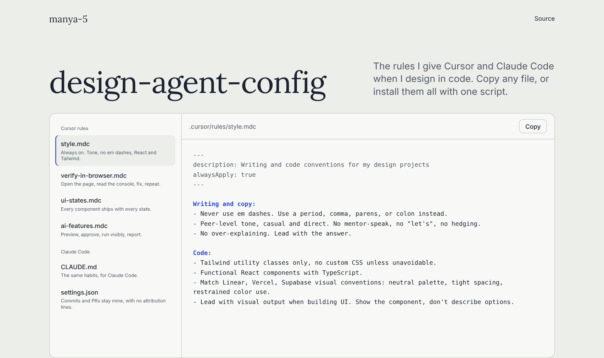

# design-agent-config

My Cursor rules and Claude Code setup for designing in code.



**Live:** https://manya-5.github.io/design-agent-config/

## Why I built this

I design in code more than in mockups now, and the AI tools do better work when they know how I like things done. Keeping the rules in one repo means every new project starts with the same habits. It also makes them easy to share.

## How it works

| File | Goes in | What it does |
|---|---|---|
| `cursor/rules/style.mdc` | `.cursor/rules/` | Always on. Writing tone, no em dashes, React with TypeScript and Tailwind. |
| `cursor/rules/verify-in-browser.mdc` | `.cursor/rules/` | Opens the page, reads the console, fixes errors and repeats until it's clean. |
| `cursor/rules/ui-states.mdc` | `.cursor/rules/` | For `.tsx` and `.jsx` files. Every component ships with empty, loading, error and interaction states. |
| `cursor/rules/ai-features.mdc` | `.cursor/rules/` | How to design AI features people can preview, approve, stop and undo. |
| `claude/CLAUDE.md` | `~/.claude/` | The same habits, written for Claude Code. |
| `claude/settings.json` | `~/.claude/` | Keeps commits and pull requests free of attribution lines. |

`style.mdc` and `verify-in-browser.mdc` come from my own projects. Rules tied to specific client or work repos are left out.

## Run it locally

```bash
git clone https://github.com/manya-5/design-agent-config.git
cd design-agent-config
./install.sh /path/to/your/project
```

The script copies the Cursor rules into your project and the Claude Code files into `~/.claude`. It never overwrites a file that already exists.

To preview the site, run `./scripts/sync-docs.sh`, then `python3 -m http.server 8000 --directory docs` and open http://localhost:8000.
